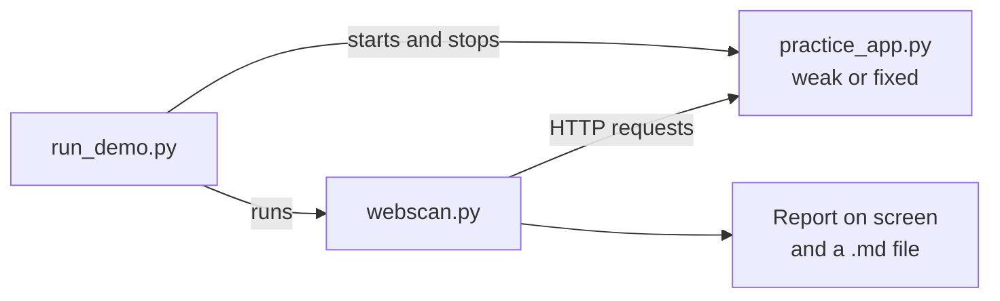

# Webscan: Design Document

**Project:** Webscan, a small Python tool that checks a website and its API for common weaknesses

## 1. Purpose and scope

Broken access control and security misconfiguration are among the most common website risks (OWASP Top 10, 2025), settings checkers do not test who can see what, while permission testing needs specialist tools or skills.

Webscan is a small, easy-to-run tool that combines both kinds of checks:

1. **Settings checks:** security headers, server version, cookie flags.
2. **Access checks:** can anyone, or the wrong user, reach data or pages they should not?
3. **Response checks:** do replies leak information to an attacker?

It ships with a practice website that is weak on purpose (and a fixed version), so the tool can be tested safely and shown to tell the two apart.

### Design goals

| Goal | How the design meets it |
|---|---|
| Simple to run | Two libraries (Requests, Flask), one command to scan, one command for the full demo |
| Safe by design | Refuses non-local targets unless `--i-have-permission` is given; only sends normal requests, never attack payloads |
| Explains itself | Every failed check shows what was seen and how to fix it |
| Testable | A weak and a fixed practice site give a known expected result: 15 of 16 checks fail on weak, all 16 pass on fixed |

## 2. Architecture

| File | Role |
|---|---|
| `webscan.py` | The scanner. A `Scanner` class runs the 16 checks, each producing a `Result` (group, name, PASS/FAIL/SKIPPED, what was seen, how to fix it). Also builds the Markdown report. |
| `practice_app.py` | Flask practice website with a `--mode weak` and `--mode fixed` switch. Fake data only. Listens on 127.0.0.1 only. |
| `run_demo.py` | Starts the practice site in each mode, scans it, stops it, and saves both reports in `reports/`. |

### Scan flow

1. **Safety gate.** If the target host is not `localhost` or a loopback address and `--i-have-permission` was not given, stop with exit code 2.
2. **Log in** as a normal user (`alice` by default) and keep the session cookie.
3. **Settings and headers** checks on the home page.
4. **Cookie** checks on the cookie(s) set by the login reply.
5. **Access** checks (with and without the login cookie).
6. **Response** checks (bad logins, a bad request, and a scan of every reply body seen).
7. **Report** printed on screen and saved to a Markdown file.
8. **Exit code:** 0 if all checks pass, 1 if any fail, 2 if the tool could not run.

If the login fails, the checks that need a logged-in user are marked **SKIPPED** instead of guessing a result.

## 3. The 16 checks

| ID | Group | Check | How it is tested | Passes when |
|---|---|---|---|---|
| H1 | Settings and headers | Content-Security-Policy is set | `GET /`, read headers | Header present |
| H2 | Settings and headers | Strict-Transport-Security is set | `GET /` | Header present with `max-age` |
| H3 | Settings and headers | X-Content-Type-Options is nosniff | `GET /` | Header equals `nosniff` |
| H4 | Settings and headers | Clickjacking protection is set | `GET /` | `X-Frame-Options` present, or CSP has `frame-ancestors` |
| H5 | Settings and headers | Referrer-Policy is set | `GET /` | Header present |
| H6 | Settings and headers | Server version is hidden | `GET /` | No version number in `Server` or `X-Powered-By` |
| C1 | Cookies | Cookies are HttpOnly | Read `Set-Cookie` from the login reply | Every cookie has `HttpOnly` |
| C2 | Cookies | Cookies are Secure | Same | Every cookie has `Secure` |
| C3 | Cookies | Cookies have SameSite | Same | Every cookie has `SameSite=` |
| A1 | Access | Orders need a login | `GET /api/orders/1` with no cookie | Redirect, 401, 403 or 404 |
| A2 | Access | Users cannot read other users' orders | Log in as alice, `GET /api/orders/2` (bob's) | Anything except 200 |
| A3 | Access | Normal users cannot open the admin page | Log in as alice, `GET /admin` | Redirect, 401, 403 or 404 |
| A4 | Access | The admin page needs a login | `GET /admin` with no cookie | Redirect, 401, 403 or 404 |
| R1 | Responses | Login errors do not reveal which users exist | Log in as an unknown user, then as a real user with a wrong password | Same status code and same message for both |
| R2 | Responses | Error pages do not show internal details | `GET /api/orders/not-a-number` as alice | No traceback, file paths or framework names in the reply |
| R3 | Responses | Replies do not contain passwords or secrets | Scan every reply body seen during the scan | No `password`, `secret`, `api_key` or similar field names |

A2 is the BOLA/IDOR problem described in Week 1 (one user reading another user's data).

## 4. The practice website

Fake data only: users `alice` and `bob` (normal) and `admin`; order 1 belongs to alice and order 2 to bob.

| Endpoint | Purpose |
|---|---|
| `GET /` | Home page (headers are checked here) |
| `POST /api/login` | JSON `{"username", "password"}`; sets a `session` cookie |
| `GET /api/orders/<id>` | Returns an order |
| `GET /admin` | Admin page |

| Area | Weak version | Fixed version |
|---|---|---|
| Safety headers | None sent | CSP, HSTS, nosniff, X-Frame-Options, Referrer-Policy |
| Version | `X-Powered-By: Flask 3.0.0` and the server's own version in `Server` | Version hidden |
| Cookie | No flags | HttpOnly, Secure, SameSite=Strict |
| Orders without login | Returned | 401 |
| Another user's order | Returned | 404 |
| Admin page, normal user | Opens | 403 |
| Admin page, no login | 401 (the one check the weak site passes) | 401 |
| Login errors | "No such user" vs "Wrong password for alice" | One message: "Invalid username or password" |
| Bad request | Python traceback shown | Short generic error |
| Order reply | Includes `owner_password` and `internal_api_key` | Only id, item, total, owner |

## 5. Design decisions

1. **Python with Requests.** Short, readable code that is easy to explain and extend.
2. **Cookie header built by hand.** The Requests cookie jar will not send a `Secure` cookie over plain `http://`, which would break the scan of the fixed version on localhost. Webscan reads the `Set-Cookie` lines and sends the cookie itself.
3. **Safety gate on the hostname.** Only `localhost` and loopback addresses count as "on your own computer". No DNS lookup is done.
4. **Three states, not two.** A check that cannot run is SKIPPED rather than reported as a pass or a fail.
5. **Redirect, 401, 403 and 404 all count as "denied".** Some sites hide pages by returning 404.
6. **Markdown report.** Readable on screen, and renders on GitHub.
7. **Check count.** The Week 1 text lists 5 header settings plus the version check, two cookie protections, three access checks and three response checks (14), but also says "16 checks". To reach 16, the cookie check was split into three (HttpOnly, Secure, SameSite) and a fourth access check was added (the admin page needs a login). The weak site passes exactly that one check, which gives the expected 15 of 16 failures.

## 6. Limitations

- Checks a short list of well-known weaknesses and does not try to break in.
- Supports one login style: a JSON POST that returns a session cookie.
- Checks that headers are present, not that their values are strong.
- The secrets check looks for field names, so it can give false alarms.
- Only tested against the included practice website. Other sites will need `--login-path`, `--orders-path` and `--admin-path`, and may use a login style Webscan does not support.
- A passing report does not mean a website is fully secure.

## 7. Status and next steps

| Item | Status |
|---|---|
| Design | Done (this document) |
| Practice website (weak and fixed) | Done |
| Scanner with 16 checks and report | Done |
| Safety gate | Done and tested (refuses `https://example.com`) |
| Weak scan: 15 of 16 fail | Done, see `docs/TEST_RESULTS.md` |
| Fixed scan: 16 of 16 pass | Done, see `docs/TEST_RESULTS.md` |
| One-command demo | Done (`run_demo.py`) |

Possible next steps: test against a second target such as OWASP Juice Shop, support more login styles (bearer tokens), add a JSON report, and judge header values as well as their presence.
