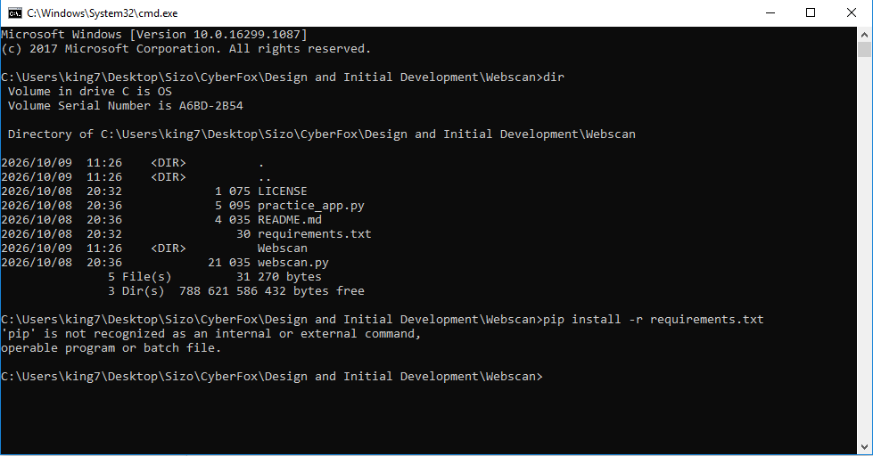
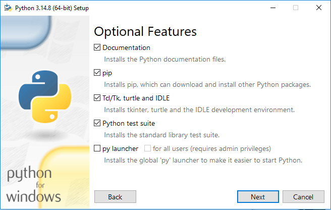
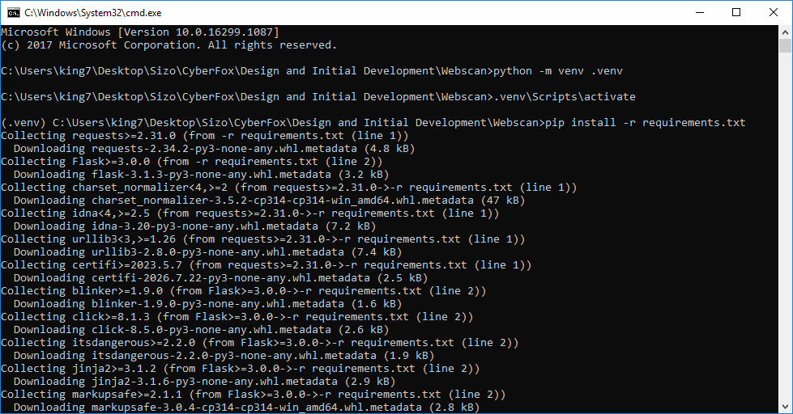
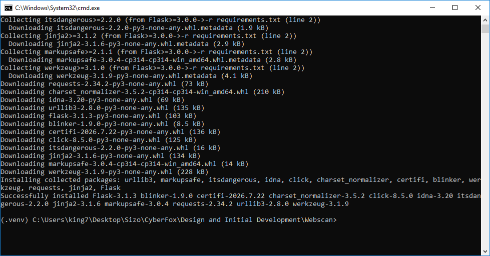
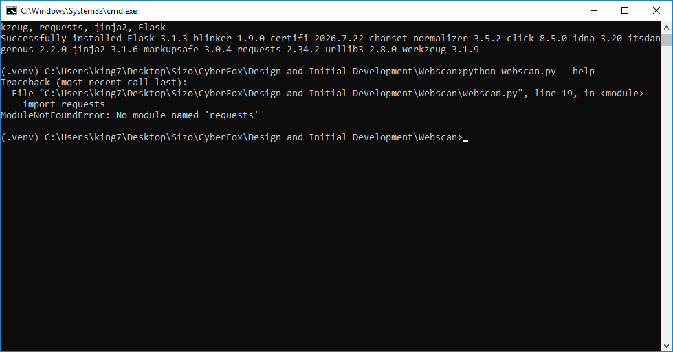
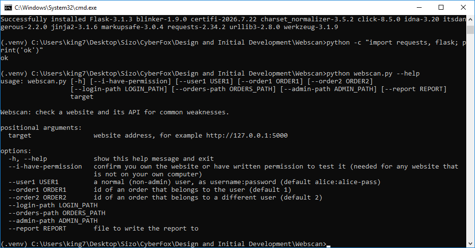
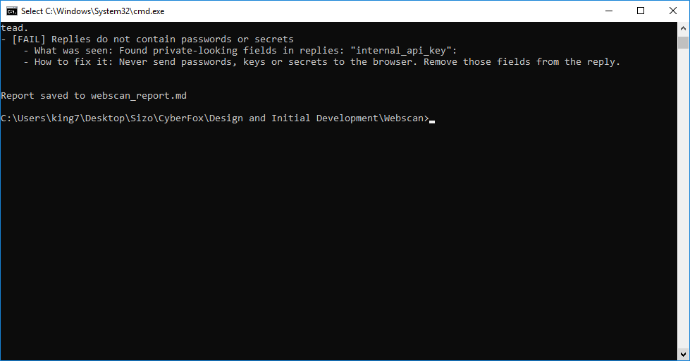
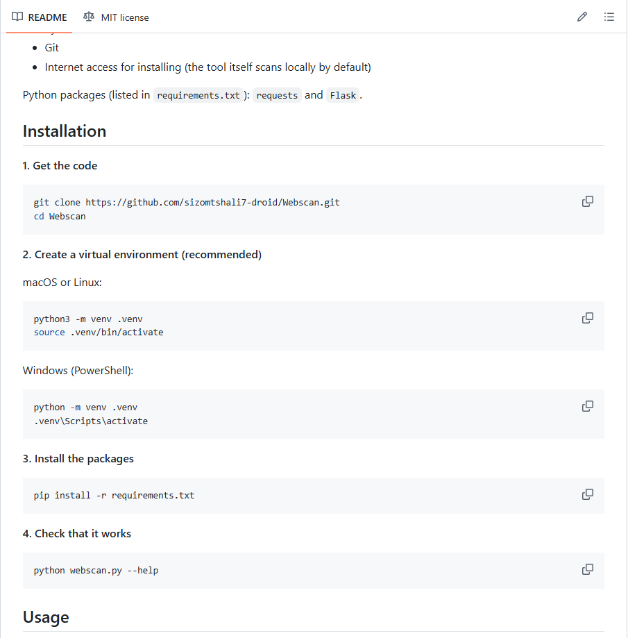

# Webscan: Development Log and Problems Faced

Week 2, Design and Initial Development. This log records how Webscan was set up and run on my computer, the problems I ran into, and how each one was fixed. Screenshots are in the `screenshots/` folder.

**My setup:** Windows 10 version 1709 (build 16299.1087), Command Prompt (`cmd.exe`), Python 3.14.8 (64-bit), Flask 3.1.3, Requests 2.34.2, Werkzeug 3.1.9.

## Summary

| # | Problem | Where it happened | Status |
|---|---|---|---|
| 1 | `'pip' is not recognized` | Installing the packages | Fixed |
| 2 | Python installer not supported on my Windows 10 version | Installing Python | Fixed |
| 3 | `ModuleNotFoundError: No module named 'requests'` | First run of `webscan.py` | Fixed |
| 4 | `The system cannot find the file specified` when renaming the report | Saving the weak report | No harm, explained |
| 5 | README said PowerShell, but I used Command Prompt | Following the README | README updated |
| 6 | Fixed site failed one check during testing | Building the practice site | Fixed |
| 7 | Week 1 listed 14 checks but said 16 | Designing the checks | Resolved in the design |
| 8 | The secrets check named only one of two leaked fields | Reading the weak scan | Fixed |

## What went wrong, and how it was fixed

### Problem 1: `pip` is not recognised

**What happened.** In the project folder (`dir` showed `LICENSE`, `README.md`, `practice_app.py`, `requirements.txt`, `webscan.py`), I ran `pip install -r requirements.txt` and Windows replied that `'pip' is not recognized as an internal or external command`.



**Cause.** Python was not installed correctly, or was not on the PATH (the list of places Windows looks for commands).

**Fix.** Install Python with the **Add python.exe to PATH** option, then open a new Command Prompt. Python also lets you call pip as `python -m pip`, which works even when `pip` on its own is not found. The README now says this.

### Problem 2: The Python installer would not run on my Windows 10 version

**What happened.** The Python download from python.org was not supported on my Windows 10 version (1709, build 16299). The version shows in the title line of the first screenshot.

**Fix.** I used a standalone Python 3.14.8 (64-bit) installer instead. The screenshot shows its **Optional Features** step. I kept **pip** ticked because pip is what installs Flask and Requests, and I also ticked the **py launcher** option, which gives the `py` command.



**Lesson.** Older Windows 10 builds cannot always run the newest installer, so the README now tells people to pick a classic installer from the python.org Windows downloads page if the default one fails.

### Problem 3: `ModuleNotFoundError: No module named 'requests'`

**What happened.** I created the virtual environment (`python -m venv .venv`) and activated it (`.venv\Scripts\activate`, shown by `(.venv)` at the start of the prompt). `pip install -r requirements.txt` finished with "Successfully installed Flask-3.1.3 ... requests-2.34.2 ...".




Then `python webscan.py --help` failed at `import requests`:



**Cause.** `pip` and `python` were pointing at different Python setups, so the packages were installed in one place and Python looked in another.

**Fix.** Run pip through Python itself so both always match:

```
python -m pip install -r requirements.txt
```

Afterwards `python -c "import requests, flask; print('ok')"` printed `ok` and `python webscan.py --help` showed Webscan's help screen.



The README now uses `python -m pip` everywhere.

### Problem 4: Renaming the weak report failed

**What happened.** After the weak scan I tried `ren webscan_report.md report_weak.md` and got `The system cannot find the file specified`.

**Cause.** There was no file called `webscan_report.md` any more. File Explorer showed the weak report already saved as `webscan_report_weak` (an MD file dated 15:04, the time of the scan), so it had already been renamed.

**Result.** Nothing was lost. I then scanned the fixed version with `--report webscan_report_fixed.md` so the two reports have matching names. `run_demo.py` now does this automatically and saves both in a `reports/` folder.

At that point my project folder also contained the 32 MB Python installer and the `.venv` folder, which must **not** go on GitHub. A `.gitignore` file now covers both.

### Problem 5: README said PowerShell, I used Command Prompt

**What happened.** The README labelled the Windows steps "PowerShell", but all my screenshots are from Command Prompt (`cmd.exe`). The commands are the same for this project, so it still worked.

**Fix.** The README now says "Command Prompt or PowerShell". If PowerShell refuses to run the activate script, use Command Prompt.

### Problem 6: The fixed site failed one check (found during testing)

**What happened.** On the first test, the fixed practice site passed 15 checks and failed "Server version is hidden". The report showed two `Server` headers, one set by the practice app and one added by Flask's built-in server (`Werkzeug/... Python/...`).

**Fix.** In fixed mode the practice site now uses a small custom request handler that replaces the server's version string. After that the fixed site passed all 16 checks.

### Problem 7: 14 checks in Week 1 versus 16

**What happened.** The Week 1 text describes five header settings plus the version check, two cookie protections, three access checks and three response checks, which is 14, but it also says 16 checks and "the weak version fails 15 of the 16".

**Resolution.** To reach 16, the cookie check became three checks (HttpOnly, Secure, SameSite) and a fourth access check was added (the admin page needs a login). The weak site passes only that check, so it fails 15 of 16. See section 5 of `DESIGN.md`.

### Problem 8: The secrets check named only one leaked field

**What happened.** In the weak scan, the replies contained both `owner_password` and `internal_api_key`, but the report listed only `internal_api_key`.



**Cause.** The check stopped at the first match in each reply.

**Fix.** The check now collects every private-looking field name from every reply, so the weak report lists both. The screenshots in this repository were taken before this fix; reports made with the current code show both fields.

## What worked first time

- Creating and activating the virtual environment.
- The safety gate: scanning `https://example.com` without `--i-have-permission` is refused.
- The weak scan result: **1 passed, 15 failed, 0 skipped**.
- The fixed scan result: **16 passed, 0 failed, 0 skipped**.
- The README published on GitHub:



## Housekeeping

Screenshots were cropped to the Command Prompt, File Explorer, installer or README area only, so they do not show browser tabs or other personal information.
