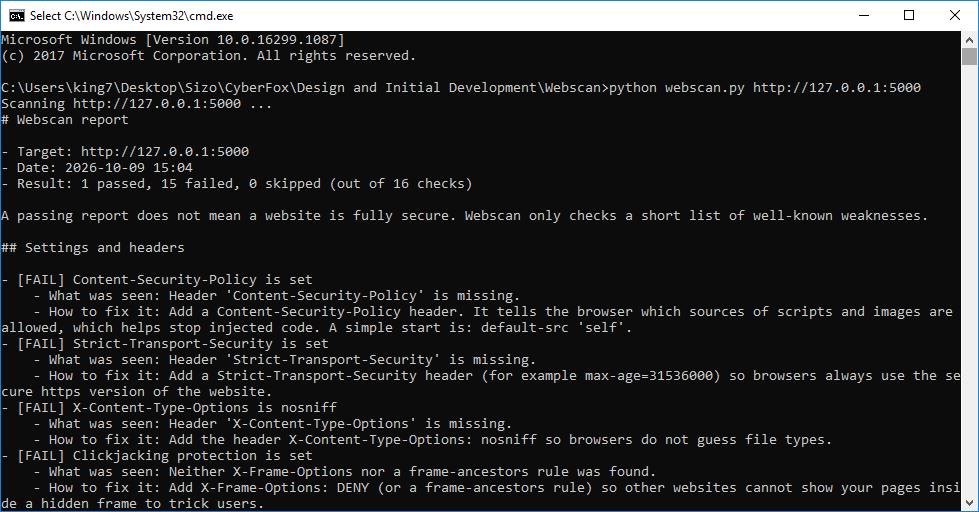
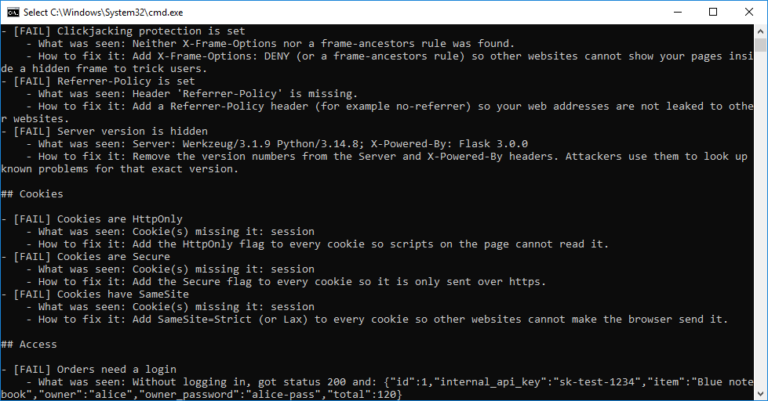
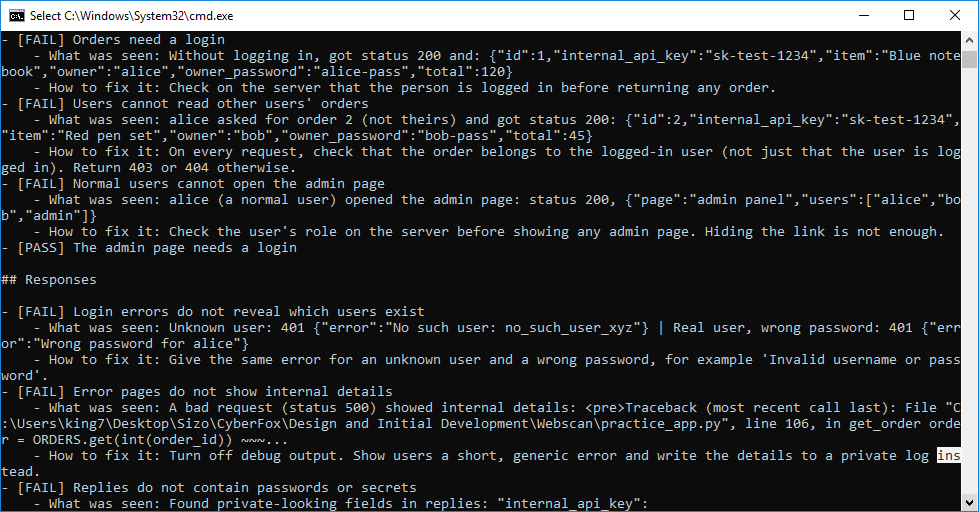
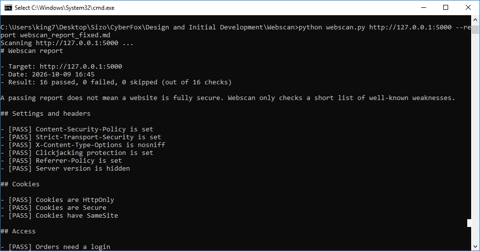
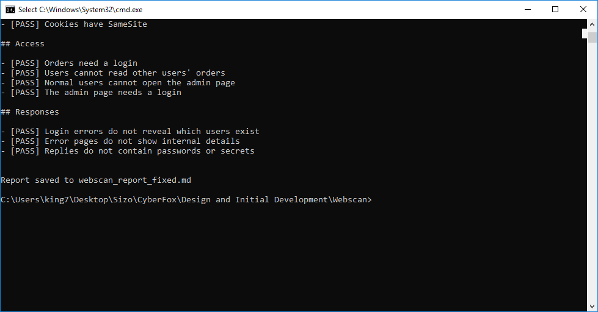

# Webscan: Test Results

## Test setup

| Item | Value |
|---|---|
| Computer | Windows 10 version 1709 (build 16299.1087) |
| Python | 3.14.8 (64-bit) in a virtual environment |
| Packages | Flask 3.1.3, Requests 2.34.2, Werkzeug 3.1.9 |
| Target | The included practice website at `http://127.0.0.1:5000` |
| Weak scan | 9 October 2026, 15:04 |
| Fixed scan | 9 October 2026, 16:45 |

During development the same checks were also run on Linux with Python 3.12 and gave the same results.

## Result at a glance

| Practice website | Passed | Failed | Skipped | Expected |
|---|---|---|---|---|
| Weak version | 1 | 15 | 0 | 15 of 16 fail |
| Fixed version | 16 | 0 | 0 | 16 of 16 pass |

Webscan can tell the weak site from the fixed site, which is what the Week 1 plan set out to show.

## Result for each check

| ID | Check | Weak | Fixed | What Webscan saw on the weak site |
|---|---|---|---|---|
| H1 | Content-Security-Policy is set | FAIL | PASS | Header missing |
| H2 | Strict-Transport-Security is set | FAIL | PASS | Header missing |
| H3 | X-Content-Type-Options is nosniff | FAIL | PASS | Header missing |
| H4 | Clickjacking protection is set | FAIL | PASS | No X-Frame-Options and no frame-ancestors rule |
| H5 | Referrer-Policy is set | FAIL | PASS | Header missing |
| H6 | Server version is hidden | FAIL | PASS | `Server: Werkzeug/3.1.9 Python/3.14.8` and `X-Powered-By: Flask 3.0.0` |
| C1 | Cookies are HttpOnly | FAIL | PASS | `session` cookie missing the flag |
| C2 | Cookies are Secure | FAIL | PASS | `session` cookie missing the flag |
| C3 | Cookies have SameSite | FAIL | PASS | `session` cookie missing the flag |
| A1 | Orders need a login | FAIL | PASS | Status 200 with order data, including `owner_password` and `internal_api_key`, without logging in |
| A2 | Users cannot read other users' orders | FAIL | PASS | alice asked for order 2 (not hers) and got status 200 |
| A3 | Normal users cannot open the admin page | FAIL | PASS | alice (a normal user) opened the admin page: status 200 |
| A4 | The admin page needs a login | **PASS** | PASS | Without logging in, got a denied status (the one check the weak site passes) |
| R1 | Login errors do not reveal which users exist | FAIL | PASS | Unknown user: 401 "No such user: ..." versus real user: 401 "Wrong password for alice" |
| R2 | Error pages do not show internal details | FAIL | PASS | A bad request returned status 500 with a Python traceback and the file path of `practice_app.py` |
| R3 | Replies do not contain passwords or secrets | FAIL | PASS | Private-looking fields in replies (see note below) |

**Note on R3.** The screenshots of the weak scan list only `internal_api_key`. The check was improved after those screenshots were taken and now lists every field, so a new weak report shows `internal_api_key, owner_password`. The pass or fail result did not change.

## Evidence

### Weak version (1 passed, 15 failed)






### Fixed version (16 passed, 0 failed)




## Other tests

| Test | Result |
|---|---|
| Scan `https://example.com` without `--i-have-permission` | Refused, exit code 2, no request sent |
| `python webscan.py --help` | Help screen shown (see `screenshots/07-webscan-help-working.png`) |
| Exit codes | 0 when all checks pass, 1 when any fail, 2 when the tool cannot run |

## How to repeat the test

One command (starts the practice website, scans both versions, saves the reports):

```
python run_demo.py
```

The reports are saved as `reports/webscan_report_weak.md` and `reports/webscan_report_fixed.md`.

Or step by step:

```
python practice_app.py --mode weak --port 5000
python webscan.py http://127.0.0.1:5000 --report reports/webscan_report_weak.md
```

Stop the site (Ctrl+C), then repeat with `--mode fixed` and `reports/webscan_report_fixed.md`.

## Limits of these tests

- Only the included practice website was tested. Webscan has not been run against OWASP Juice Shop, crAPI or any other site.
- The practice website was written to match the checks, so the results show that the checks work as designed, not how common these problems are in real websites.
